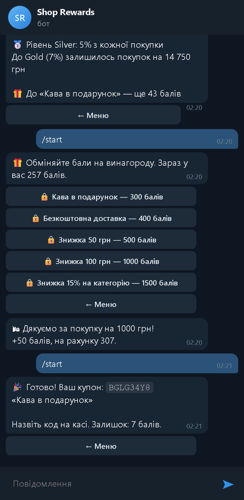
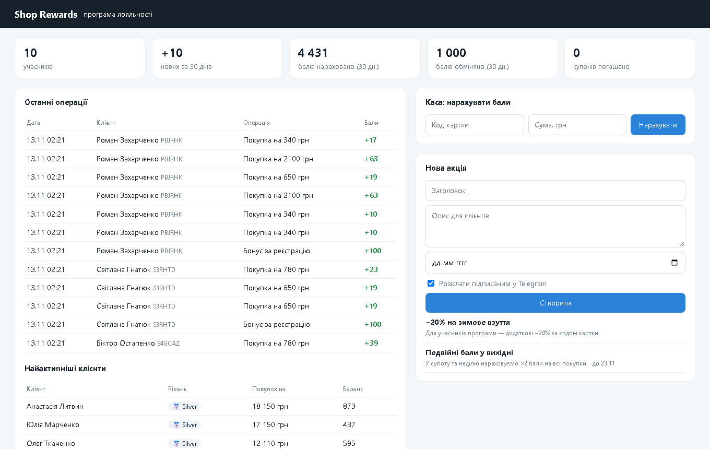

# Shop Rewards — Telegram-бот програми лояльності

Бонусна картка магазину в Telegram: клієнт бачить баланс, отримує бали за покупки, обмінює їх на винагороди і дізнається про акції. Касир нараховує бали за кодом картки — з панелі або командою в Telegram.

| Баланс і рівень | Обмін балів на купон |
| --- | --- |
|  |  |



## Як працює

- **Реєстрація** — `/start` і «Поділитися номером»; клієнт отримує код картки (без схожих символів 0/O, 1/I, щоб касиру було легко ввести) і вітальні бали
- **Рівні** — Bronze 3%, Silver 5% (від 5 000 грн покупок), Gold 7% (від 20 000 грн). При переході на новий рівень бот вітає клієнта
- **Мої бонуси** — баланс, останнє нарахування, скільки лишилось до наступного рівня і до найближчої винагороди
- **Винагороди** — каталог з позначкою, що вже доступно; обмін з підтвердженням → унікальний купон
- **Каса** — нарахування за сумою покупки (`/add КОД СУМА` або форма в панелі), погашення купона (`/coupon КОД`) з перевіркою, що він ще не використаний
- **Акції** — створюються в панелі, розсилаються тим, хто не вимкнув сповіщення
- **Історія** — останні нарахування і списання
- **Панель** — учасники, нараховані/обміняні бали, останні операції, найактивніші клієнти

## Стек

Python 3.12, aiogram 3, SQLAlchemy 2 (async), PostgreSQL, FastAPI + Jinja2, Docker.

## Запуск

```bash
cp .env.example .env
docker compose up -d --build
docker compose exec bot python -m bot.seed     # каталог винагород і акції
```

Без Docker: `pip install -r requirements.txt`, `python -m bot.seed`, `python -m bot.main` і `uvicorn webadmin.app:app --port 8080`.

## Перевірка без токена

`http://localhost:8080/dev/chat` — емулятор чату: повідомлення проходять через справжній `Dispatcher` і обробники, відповіді бота перехоплюються. Нарахування з панелі теж приходять у цей чат. Скріншоти зроблені саме так.

Тестові учасники для панелі: `python scripts/demo_customers.py`.

## Тести

```bash
pip install -r requirements-dev.txt
pytest -q
```

Рівні й округлення балів, недостатній баланс, сценарій «реєстрація → покупка → обмін → погашення купона» через обробники бота.
